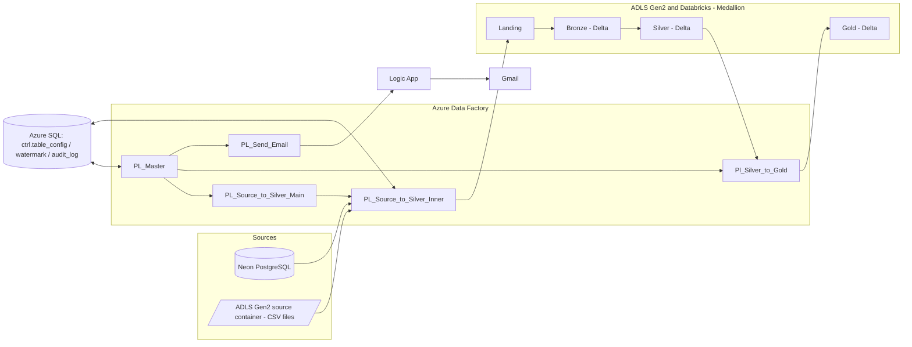

# CareSync Health Data Platform: Azure Data Factory Orchestration

A **metadata-driven** data platform on Azure. One control table drives ingestion, transformation, audit logging and email alerting. Adding a new table is a **config row**, not a new pipeline.

**Stack:** Azure Data Factory · Azure Databricks (PySpark, Delta Lake) · ADLS Gen2 · Azure SQL Database · Azure Logic Apps · Azure Key Vault · GitHub

---

## Table of contents

1. [Architecture](#architecture)
2. [Key features](#key-features)
3. [Repository structure](#repository-structure)
4. [Pipelines](#pipelines)
5. [Control tables](#control-tables)
6. [Source handling](#source-handling)
7. [Load types and watermark logic](#load-types-and-watermark-logic)
8. [Audit logging and run ID propagation](#audit-logging-and-run-id-propagation)
9. [Email alerting (Logic App)](#email-alerting-logic-app)
10. [Databricks notebooks](#databricks-notebooks)
11. [Setup guide](#setup-guide)
12. [How to run](#how-to-run)
13. [How to add a new table](#how-to-add-a-new-table)
14. [Monitoring and verification](#monitoring-and-verification)
15. [Challenges and lessons learned](#challenges-and-lessons-learned)
16. [Future improvements](#future-improvements)

---

## Architecture



**Data flow**

1. `PL_Master` starts the run and creates one run ID.
2. `PL_Source_to_Silver_Main` reads the active tables for a source system from `ctrl.table_config`, then runs `PL_Source_to_Silver_Inner` for each table in parallel.
3. The inner pipeline copies data to **Landing**, then Databricks notebooks load **Bronze** and **Silver**.
4. `Pl_Silver_to_Gold` runs one Databricks notebook for each active gold table.
5. `PL_Send_Email` reads the audit log for the run and sends an HTML status table through a Logic App.

---

## Key features

- **Config-driven ingestion:** one control table decides which tables load, from where, and how.
- **Multiple sources:** PostgreSQL (Neon) and CSV files in ADLS Gen2, routed with a **Switch** activity.
- **Medallion architecture:** Landing → Bronze → Silver → Gold with Delta tables.
- **Three load types:** FULL, MERGE and APPEND.
- **Incremental loads:** column-based watermark for PostgreSQL and last-modified-time filtering for CSV files.
- **Audit logging:** every table and stage is logged as `IN_PROGRESS`, `SUCCESS` or `FAILED`, with a row count.
- **Single run ID:** the master run ID flows to every child pipeline, so one run is fully traceable.
- **Failure isolation:** one failing table doesn't stop the others, and failures are logged and reported.
- **Graceful empty runs:** an incremental run with no new data ends as `SUCCESS` with 0 records.
- **Automated email report:** an HTML table of every table's status, with the overall result in the subject line.
- **Secrets management:** credentials are stored in Azure Key Vault, and nothing sensitive is committed to the repo.

---

## Repository structure

> Adjust to match your repo.

```
.
├── pipeline/               # ADF pipeline JSON
│   ├── PL_Master.json
│   ├── PL_Source_to_Silver_Main.json
│   ├── PL_Source_to_Silver_Inner.json
│   ├── Pl_Silver_to_Gold.json
│   └── PL_Send_Email.json
├── dataset/                # ADF datasets
├── linkedService/          # ADF linked services (no secrets)
├── factory/                # Global parameters
├── sql/                    # Control table DDL and seed data
├── logic-app/              # Logic App workflow definition
├── databricks/             # Notebooks (landing_to_bronze, bronze_to_sliver, Gold/*)
├── docs/                   # Architecture diagram and screenshots
└── README.md
```

---

## Pipelines

| Pipeline | Role | Parameters |
|---|---|---|
| `PL_Master` | Entry point. Runs everything in order and passes the run ID down. | none |
| `PL_Source_to_Silver_Main` | Reads active tables for one source system and runs the inner pipeline for each, in parallel (ForEach). Writes the `IN_PROGRESS` and `FAILED` audit rows. | `source_system`, `adf_run_id` |
| `PL_Source_to_Silver_Inner` | Processes one table: reads config, sets timestamps, reads the watermark, copies to Landing, runs the Bronze and Silver notebooks, updates the watermark and writes the `SUCCESS` audit row. | `table_id`, `adf_run_id` |
| `Pl_Silver_to_Gold` | Runs one notebook for each active gold table and writes audit rows. | `adf_run_id` |
| `PL_Send_Email` | Builds the email subject, header, footer and status table, then calls the Logic App. | `adf_run_id` |

### `PL_Master` execution order

```
Source to Silver (Postgres) ─┐
                             ├─► Silver to Gold ─► Send Email
Source to Silver (ADLS) ─────┘
```

`Silver to Gold` and `Send Email` run on the `Completed` condition, so the report is sent even when something fails.

### `PL_Source_to_Silver_Inner` activity flow

```
Read_Tabel_details (Lookup)
Set Start Time ─► Set New Watermark
        └────────┬────────┘
          check load type (If: not FULL ─► Read water_mark ─► store_watermark_value)
                 ▼
          check source system (Switch)
             ├─ neon_postgres ─► Copy: PostgreSQL ─► Parquet in Landing
             ├─ adls_csv      ─► Copy: Binary copy of CSV files into Landing
             └─ default       ─► Fail (unsupported source_system)
                 ▼
          Landing_to_bronze (Databricks notebook)
                 ▼
          bronze_to_sliver (Databricks notebook)
                 ▼
          Checking load type and update watermark (If: not FULL ─► update ctrl.watermark)
                 ▼
          update_success_status (Script ─► ctrl.audit_log)
```

---

## Control tables

All control tables live in Azure SQL Database under the `ctrl` schema.

### `ctrl.table_config`: what to load and how

| Column | Purpose |
|---|---|
| `table_id` | Unique ID |
| `source_system` | `neon_postgres`, `adls_csv` or `silver` (for gold rows) |
| `source_schema_name` | Source schema (PostgreSQL) |
| `source_table_name` | Source table name |
| `source_file_format` | `csv` for file sources |
| `source_path` | Folder in the `source` container (CSV sources) |
| `bronze_table_name` / `silver_table_name` / `gold_table_name` | Target table names |
| `load_type` | `FULL`, `MERGE` or `APPEND` |
| `watermark_column` | Column used for incremental loads (PostgreSQL) |
| `merge_keys` | Business keys for MERGE |
| `stage` | `SOURCE_TO_SILVER` or `SILVER_TO_GOLD` |
| `is_active` | Only rows with `'True'` run |

Current configuration:

| table_id | Source | Table | Load type | Stage |
|---|---|---|---|---|
| 1 | neon_postgres | hospitals | FULL | SOURCE_TO_SILVER |
| 2 | neon_postgres | doctors | FULL | SOURCE_TO_SILVER |
| 3 | neon_postgres | patients | MERGE (`patient_id`, watermark `updated_at`) | SOURCE_TO_SILVER |
| 4 | adls_csv | lab_results | APPEND | SOURCE_TO_SILVER |
| 5 | adls_csv | insurance_providers | FULL | SOURCE_TO_SILVER |
| 6 | silver | patient_360 | FULL | SILVER_TO_GOLD |
| 7 | silver | hospital_daily_summary | FULL | SILVER_TO_GOLD |
| 8 | silver | lab_test_trends | FULL | SILVER_TO_GOLD |

### `ctrl.watermark`: incremental state

| Column | Purpose |
|---|---|
| `table_id` | Links to `table_config` |
| `watermark_value` | Last successful load time (UTC, ISO format) |
| `last_updated_timestamp` | When the watermark was last changed |

### `ctrl.audit_log`: run history

| Column | Purpose |
|---|---|
| `adf_run_id` | The `PL_Master` run ID (shared by every row of a run) |
| `table_id` | Which table |
| `stage` | `SOURCE_TO_SILVER` or `SILVER_TO_GOLD` |
| `status` | `IN_PROGRESS`, `SUCCESS` or `FAILED` |
| `records_written` | Row count returned by the notebook |
| `start_time` / `end_time` | Timing |

---

## Source handling

The inner pipeline routes on `source_system` with a **Switch** activity.

### PostgreSQL (`neon_postgres`)

- **Copy activity** with a `PostgreSqlV2Source` and a Parquet sink.
- FULL load: `SELECT * FROM <table>`.
- Incremental load: adds `WHERE <watermark_column> > '<watermark_value>'`.
- Output path: `landing/<source_system>/<table>/<timestamp>/`.

### CSV files (`adls_csv`)

- **Binary copy** of the files into Landing, so the raw file is preserved.
- Files are selected by `wildcardFileName = *.csv` and by **last-modified time** (`modifiedDatetimeStart` and `modifiedDatetimeEnd`).
- FULL load uses `1900-01-01T00:00:00Z` as the start time, so every file is read.
- Parsing the CSV happens later in Databricks (`landing_to_bronze`).

### Unknown source

The Switch default case runs a **Fail** activity with a clear message, so a mistyped `source_system` fails loudly instead of silently doing nothing.

---

## Load types and watermark logic

| Load type | Bronze | Silver | Watermark |
|---|---|---|---|
| `FULL` | Full reload | Overwrite | Not used |
| `MERGE` | New and changed rows | `MERGE` on `merge_keys` | Used |
| `APPEND` | New rows | Append | Used |

- `Set New Watermark` captures `utcNow()` in ISO format **at the start of the run**. That value is saved after a successful load, so rows arriving during the run are picked up next time and not skipped.
- For CSV sources the watermark is compared against the **file modified time**, so "incremental" means "new or updated files".
- If no new data exists, the Copy writes no folder. The notebook detects this, exits with `"0"` and the run ends as `SUCCESS` with `records_written = 0`.

---

## Audit logging and run ID propagation

A single run ID is created in `PL_Master` and passed down:

```
PL_Master  (@pipeline().RunId)
   ├─► PL_Source_to_Silver_Main   adf_run_id = @pipeline().RunId
   │       └─► PL_Source_to_Silver_Inner   adf_run_id = @pipeline().parameters.adf_run_id
   ├─► Pl_Silver_to_Gold          adf_run_id = @pipeline().RunId
   └─► PL_Send_Email              adf_run_id = @pipeline().RunId
```

For each table the lifecycle is:

1. `Ingest_inprogress_status` inserts an `IN_PROGRESS` row.
2. On success, the inner pipeline updates the row to `SUCCESS` with `records_written`.
3. On failure, `update_failed_status` updates it to `FAILED`, then a **Fail** activity makes the failure visible in Monitor.

All updates are scoped by `adf_run_id`, `table_id`, `stage` **and** `status = 'IN_PROGRESS'`, so they cannot overwrite rows from other runs or stages.

Useful query:

```sql
SELECT adf_run_id, table_id, stage, status, records_written, start_time, end_time
FROM ctrl.audit_log
ORDER BY start_time DESC;
```

---

## Email alerting (Logic App)

`PL_Send_Email` builds a JSON body and sends it with a **Web activity** (`POST`, `Content-Type: application/json`) to an HTTP-triggered Logic App.

```json
{
  "subject": "Dev | SUCCESS | CARESYNC MASTER RUN",
  "email_recipients": "...",
  "body_header": "...",
  "body_footer": "...",
  "status_table": [ { "table_id": 1, "stage": "SOURCE_TO_SILVER", "status": "SUCCESS", "records_written": 53 } ]
}
```

- The subject says `FAILED` if any audit row for the run is not `SUCCESS`, otherwise `SUCCESS`.
- The Logic App turns `status_table` into an HTML table (**Create HTML table**) and sends it with Gmail.
- Global parameters used: `env`, `email_recipient`, `Logic_apps_url`.

> The Logic App URL contains a signature. Keep it in a global parameter or Key Vault, never in the repo.

---

## Databricks notebooks

| Notebook | Purpose |
|---|---|
| `landing_to_bronze` | Reads the landing folder for the run (CSV or Parquet, based on `source_file_format`), cleans column names and writes to the Bronze Delta table. Exits with `"0"` if no files exist. |
| `bronze_to_sliver` | Reads the batch from Bronze and writes to Silver according to `load_type` (overwrite, MERGE on `merge_keys`, or append). Ends with `dbutils.notebook.exit(str(row_count))`. |
| `Gold/NB_<gold_table_name>` | Builds one gold table (`patient_360`, `hospital_daily_summary`, `lab_test_trends`). |

Parameters passed by ADF: `source_system`, `table_name`, `landing_timestamp`, `source_file_format`, `load_type`, `merge_keys`.

Notebooks read from a Unity Catalog volume mapped to the `landing` container:

```
/Volumes/<catalog>/landing/landing_volume/<source_system>/<table>/<timestamp>/
```

> **Important:** notebooks must exit with a **plain number as a string**. ADF writes this value into `records_written`, and text breaks the SQL update.

---

## Setup guide

### Prerequisites

- Azure subscription
- Azure Data Factory, Azure Databricks, ADLS Gen2, Azure SQL Database, Logic App, Key Vault
- A PostgreSQL source (Neon) with the source tables
- GitHub repo connected to ADF (Git integration)

### Steps

1. **Storage:** create containers `source` and `landing`. Upload CSVs to `source/<source_path>/`, for example `source/insurance_providers/insurance_providers.csv`.
2. **Azure SQL:** create the `ctrl` schema and the three control tables (see `sql/`), then seed `table_config` and `watermark`.
3. **Databricks:**
   - Create the catalog, `landing`, `bronze`, `silver` and `gold` schemas.
   - Create an **external volume** `landing_volume` whose location is the root of the `landing` container, so ADF-written files are visible to notebooks.
   - Import the notebooks (Git folder).
4. **Key Vault:** store the connection secrets and reference them from the linked services.
5. **ADF:**
   - Create linked services (Azure SQL, Databricks, ADLS Gen2, PostgreSQL).
   - Create datasets: `AzureSqlTable1`, `PostgreSqlTable1`, `Sink_parquet`, and `ds_csv_binary` (parameters `container` and `folder`, both wired into the file path).
   - Import the pipelines.
   - Add global parameters `env`, `email_recipient`, `Logic_apps_url`.
6. **Logic App:** create the HTTP-triggered workflow with Create HTML table, Compose and Send email. Paste its URL into `Logic_apps_url`.
7. **Publish** from ADF.

---

## How to run

1. Open ADF Studio → **Author** → `PL_Master`.
2. Click **Add trigger → Trigger now** (or **Debug**). No parameters are needed.
3. Watch **Monitor → Pipeline runs**.

> Don't run the child pipelines directly. They need the `adf_run_id` that `PL_Master` provides.

---

## How to add a new table

1. Add a row to `ctrl.table_config` with the source, load type and target names, and `is_active = 'True'`.
2. For incremental tables, add a row in `ctrl.watermark` starting at `1900-01-01T00:00:00Z`.
3. For a CSV source, upload the file to `source/<source_path>/`.
4. For a gold table, add a notebook `Gold/NB_<gold_table_name>` and a row with `stage = 'SILVER_TO_GOLD'`.

No pipeline changes are needed.

---

## Monitoring and verification

After a run:

```sql
-- all rows of the latest run share one run ID
SELECT adf_run_id, table_id, stage, status, records_written
FROM ctrl.audit_log
ORDER BY start_time DESC;

-- any failures?
SELECT * FROM ctrl.audit_log WHERE status <> 'SUCCESS';
```

- **ADF Monitor:** all activities green, and the Copy output shows files or rows read and written.
- **Databricks:** `display(dbutils.fs.ls("/Volumes/<catalog>/landing/landing_volume/<source_system>/<table>/"))` lists the timestamp folder.
- **Email:** one message per run, with a status table listing every table.

---

## Challenges and lessons learned

| Problem | Cause | Fix |
|---|---|---|
| Audit rows stuck at `IN_PROGRESS` | `waitOnCompletion = false`, and the run ID was not passed to the child | `waitOnCompletion = true` and one run ID passed from the master |
| Email table empty | Children used their own run ID and the email looked up a different one | Shared `adf_run_id` passed from `PL_Master` to every child |
| Landing folder not found | Dataset ignored its `container` parameter, so files were written to `source` | Wired the dataset file system to `@dataset().container` |
| CSV Copy read zero files | Empty watermark used as the start time for a FULL load | `1900-01-01T00:00:00Z` for FULL loads |
| `InvalidRequestContent` from the Web activity | Missing quotes in the JSON body, and a typo in the `Content-Type` header | Quoted strings and a correct header |
| Logic App `from` was null | Property name mismatch (`status table` vs `status_table`) | One name in ADF, the trigger schema and the action |
| Empty incremental run failed the notebook | The notebook expected a folder that was never created | Guard that exits with `"0"` when no files exist |
| Lookup property not found | Query without a column alias | `select count(*) as fail_count` |

Main takeaway: most issues were **plumbing** problems (parameters, naming, scope), and tracing a single run ID end to end made them much easier to find.

---

## Future improvements

- Move orchestration of the Databricks steps to Databricks Workflows or Jobs
- Data quality checks (null, duplicate and schema checks) with results in the audit table
- Retry policy and alert escalation (Teams or SMS) for repeated failures
- CI/CD with automated deployment between Dev, Test and Prod
- Row-level lineage and a monitoring dashboard on top of `ctrl.audit_log`
- Schema evolution handling for incoming CSVs

---

## Author

**Michael Johnson**: Azure Data Engineer
[LinkedIn](#) · [GitHub](#)
